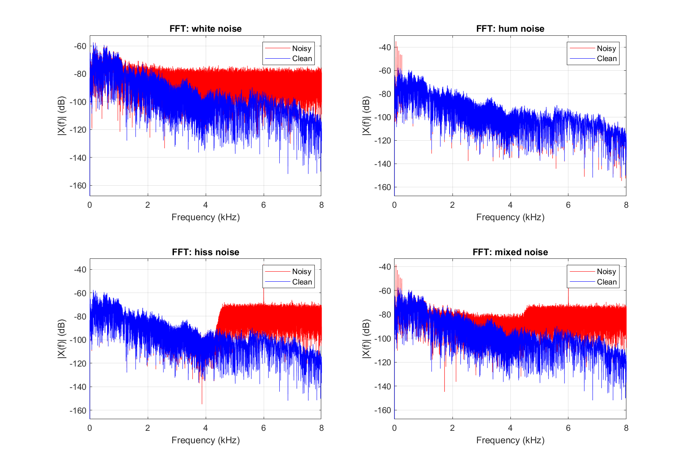
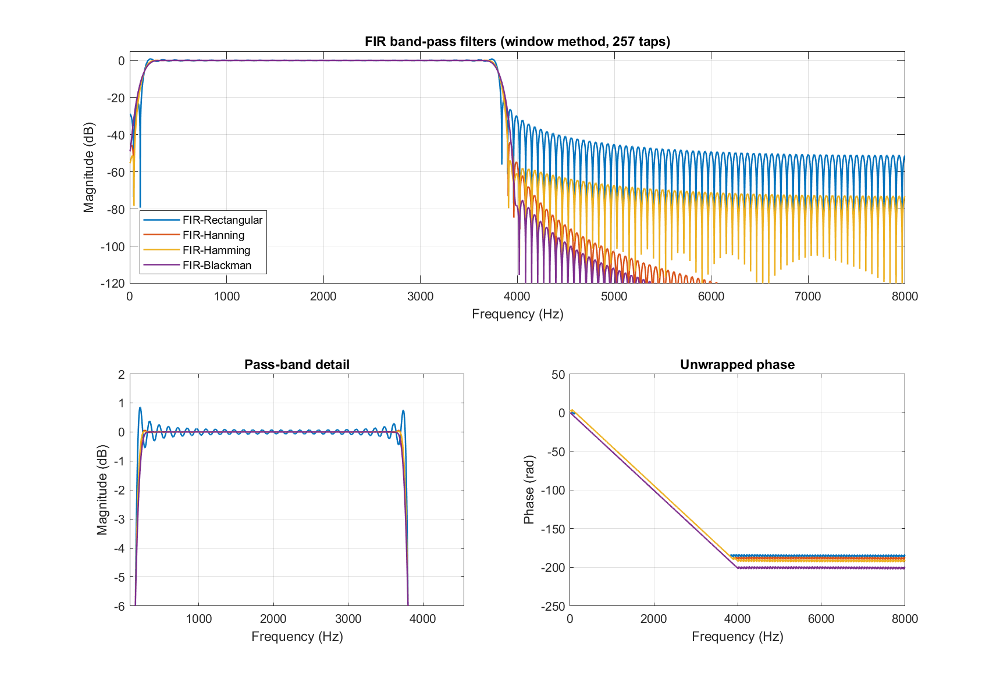
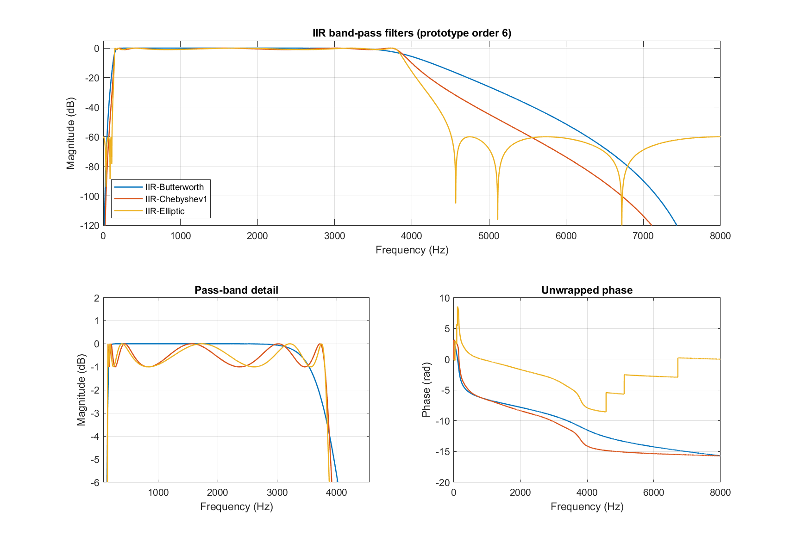
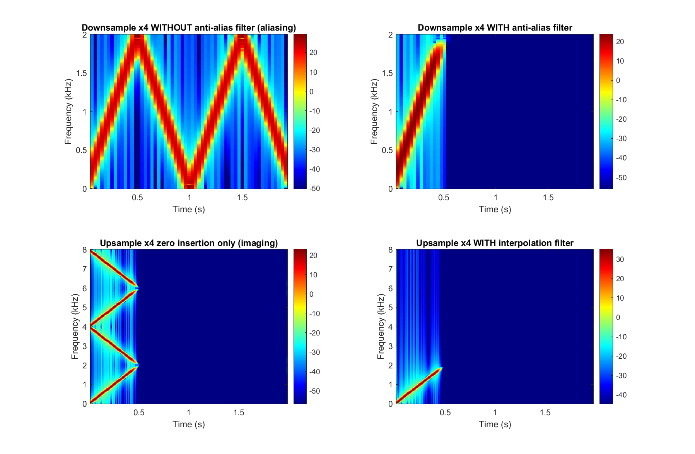
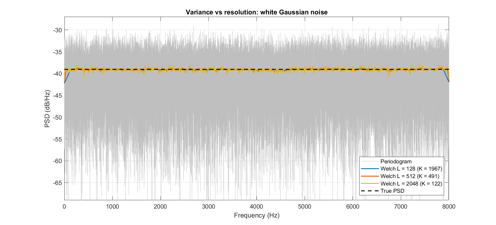
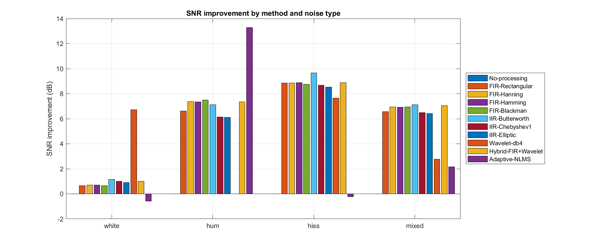
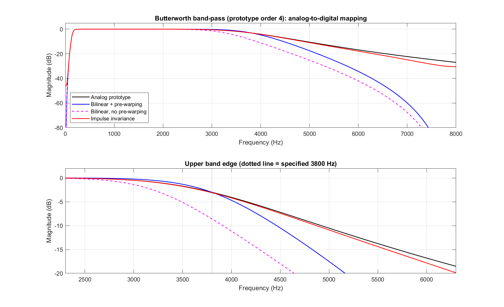
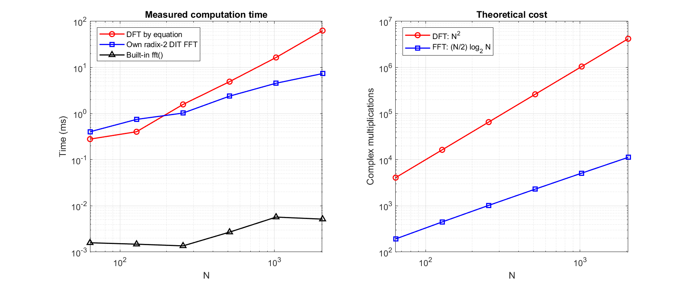

# Adaptive Audio Noise Reduction using DSP Techniques

**ECE 3204 – Digital Signal Processing Laboratory, Open-Ended Project**
Department of Electronics and Communication Engineering, KUET

This MATLAB project tests digital noise reduction on speech. A clean speech clip is corrupted with four kinds of noise. The noisy clips are then cleaned with FIR filters, IIR filters, wavelet denoising, a hybrid of filtering and wavelets, and an adaptive (NLMS) hum canceller. Every method is scored on noise reduction, distortion and runtime.

The project builds on the ECE 3204 lab experiments (DFT/FFT, FIR, IIR, multirate, PSD and wavelet). The core algorithms are **user-defined functions** written from the lab equations and then checked against MATLAB's built-in functions:

| Lab experiment | User-defined function in this project | Checked against |
|---|---|---|
| DFT / FFT | `dft_direct.m` (DFT from its equation), `fft_dit.m` (radix-2 decimation-in-time FFT) | `fft()` |
| FIR (window method, Li Tan Ch. 7) | `fir_window_design.m` (ideal response x Rectangular / Hanning / Hamming / Blackman window), `fir_length_estimate.m` (N = c fs / df) | `fir1()` |
| IIR | analog Butterworth prototype + bilinear transform (with/without pre-warping) vs impulse invariance | `butter()` |
| Multirate | anti-aliasing filter + `x(1:M:end)`, zero insertion + interpolation filter | — |
| PSD | `psd_periodogram.m`, `psd_welch.m`, `ar_psd_estimate.m` (Yule-Walker, Burg) | `periodogram`, `pwelch`, `pburg` |
| Wavelet | `dwt_periodic.m` / `idwt_periodic.m` (Haar, db2, db4, db8, sym4, coif1) | `wavedec` (energy check) |

---

## Processing workflow

```
Input WAV ─► FFT + PSD analysis (noise characterisation)
          ─► ┌ FIR filtering   (Rectangular / Hamming / Blackman window)
             ├ IIR filtering   (Butterworth / Chebyshev-I / Elliptic)
             ├ Wavelet denoising (db4 DWT, BayesShrink)
             └ Adaptive NLMS hum canceller
          ─► Multirate study (anti-aliasing / interpolation)
          ─► Evaluation (SNR, segmental SNR, log-spectral distance, runtime)
          ─► Processed WAV files + figures + tables
```

## Project tasks

| Task | What it does | File |
|---|---|---|
| 1 | Load the WAV, plot waveforms, FFT spectra and spectrograms, find the speech band and the noise peaks; DFT-by-equation and own FFT vs `fft()`, DFT vs FFT cost, FFT-based (fast) convolution vs circular convolution | `src/task1_analysis.m` |
| 2 | FIR band-pass, user-defined window method: Rectangular, Hanning, Hamming, Blackman; required length from N = c fs / df | `src/task2_fir_design.m` |
| 3 | IIR band-pass: Butterworth, Chebyshev-I, Elliptic (second-order sections), pole-zero plots, group delay; bilinear transform vs impulse invariance | `src/task3_iir_design.m` |
| 4 | Down/up-sampling by 2, 3 and 4, with aliasing and imaging shown on a chirp and on speech | `src/task4_multirate.m` |
| 5 | Periodogram vs Welch PSD, variance vs resolution trade-off, parametric AR PSD (Yule-Walker, Burg) | `src/task5_psd.m` |
| 6 | DWT wavelet denoising, comparison of threshold rules, decomposition levels and wavelet families | `src/task6_wavelet.m` |
| 7 | Run every method on every noise type, build the comparison table, sweep order and cut-off | `src/task7_evaluate.m`, `src/task7_sweeps.m` |

### Noise types (all generated with a fixed random seed)

| Name | Description | Input SNR |
|---|---|---|
| `white` | Wide-band Gaussian noise | 5 dB |
| `hum` | 50 Hz mains hum plus 5 harmonics | 0 dB |
| `hiss` | High-frequency noise above 4.5 kHz plus a 6 kHz tone | 0 dB |
| `mixed` | Hum, hiss and white noise together | 0 dB |

### Methods compared

`FIR-Rectangular`, `FIR-Hanning`, `FIR-Hamming`, `FIR-Blackman`, `IIR-Butterworth`, `IIR-Chebyshev1`, `IIR-Elliptic`, `Wavelet-db4`, `Hybrid-FIR+Wavelet`, `Adaptive-NLMS`, plus a `No-processing` baseline.

Every filter is a 150–3800 Hz band-pass. That band holds most of the useful speech energy, and it excludes both the hum and the hiss. Filtering is done forward and backward (zero phase), so FIR and IIR outputs are time-aligned with the clean reference and can be compared fairly.

### Metrics

- **SNR in / SNR out / SNR improvement** (dB)
- **Segmental SNR** (dB): frame-based, closer to how quality is perceived
- **Log-spectral distance** (dB): spectral distortion of the speech; lower is better
- **Runtime** (ms): average of several runs

---

## How to run

1. **Requirements:** MATLAB R2018b or newer with the **Signal Processing Toolbox** (used for `butter`, `cheby1`, `ellip`, `zp2sos`, `sosfilt`, `freqz`, `freqs`, `bilinear`, `impinvar`, `resample`). The Wavelet Toolbox is *not* needed, because the DWT is written from scratch. The code also runs in GNU Octave 8+ with the `signal` package.
2. Put a clean speech recording in `audio/`, ideally named `clean_speech.wav`. It should be 5–10 s of clean speech at 16 kHz or higher. Stereo is fine and other sample rates are resampled automatically.
3. Open MATLAB in the project root and run:

   ```matlab
   main
   ```

4. Everything is written to `results/` and the full run takes under a minute.

To change a parameter (filter order, cut-off, noise SNR, wavelet levels and so on), edit **`src/config.m`** only. To make figures pop up during the run, set `cfg.show_figures = true`.

## Output files

```
results/
├── figures/                 24 PNG figures (01_waveforms ... 20_order_cutoff_sweeps)
├── audio/                   clean, noisy and every processed WAV + multirate WAVs
├── results_table.csv        full comparison table (noise x method x metrics)
├── summary.txt              best method per noise type
├── task1_analysis.txt       speech band, noise components, DFT/FFT checks and timing
├── task2_fir_design.txt     required FIR length (N = c fs/df) and fir1 cross-check
├── task2_fir_specs.txt      measured FIR specs (ripple, attenuation, transition, cost)
├── task3_iir_specs.txt      measured IIR specs + bilinear vs impulse invariance
├── task4_multirate.txt      round-trip SNR for each down/up-sampling factor
├── task5_psd.txt            periodogram vs Welch variance / resolution, AR models
├── task6_wavelet_variants.txt  wavelet rule / threshold / level / family comparison
└── task7_sweeps.txt         filter order and cut-off sweeps
```

## Code structure

```
main.m                    runs all tasks in order
src/config.m              every parameter in one place
src/load_audio.m          read, mono, trim, resample, normalise
src/make_noisy_set.m      generate the 4 noisy versions at a given SNR
src/apply_filter.m        zero-phase FIR / IIR (SOS) filtering
src/dft_direct.m          DFT from its defining equation (O(N^2))
src/fft_dit.m             radix-2 decimation-in-time FFT (O(N log N))
src/fir_window_design.m   FIR window method: LP/HP/BP/BS x rect/hann/hamming/blackman
src/fir_length_estimate.m required taps N = c fs / df (Li Tan)
src/bilinear_compat.m     bilinear transform (MATLAB/Octave compatible call)
src/wavelet_denoise.m     DWT + BayesShrink / VisuShrink thresholding
src/wavelet_filter.m      Haar, db2, db4, db8, sym4, coif1 scaling filters
src/dwt_periodic.m        one-level orthogonal DWT (from scratch)
src/idwt_periodic.m       inverse DWT (perfect reconstruction)
src/nlms_hum_canceller.m  adaptive NLMS noise canceller with a 50 Hz reference
src/psd_periodogram.m     periodogram PSD (from scratch)
src/psd_welch.m           Welch PSD (from scratch)
src/ar_psd_estimate.m     AR PSD: Yule-Walker and Burg (from scratch)
src/compute_metrics.m     SNR, segmental SNR, log-spectral distance
src/filter_response.m, filter_specs.m, report_specs.m, plot_filter_set.m
src/new_figure.m, save_figure.m, plot_spectrogram.m, fft_db.m, write_wav.m
```

## Results

The full numbers are in `results/results_table.csv` and `results/summary.txt`. They come from running `main.m` on the reference clip in `audio/`. Representative figures:

| | |
|---|---|
|  |  |
|  |  |
|  |  |
|  |  |

## Author

Md.Shafe Ul Alam, Roll: 2009035 — KUET ECE